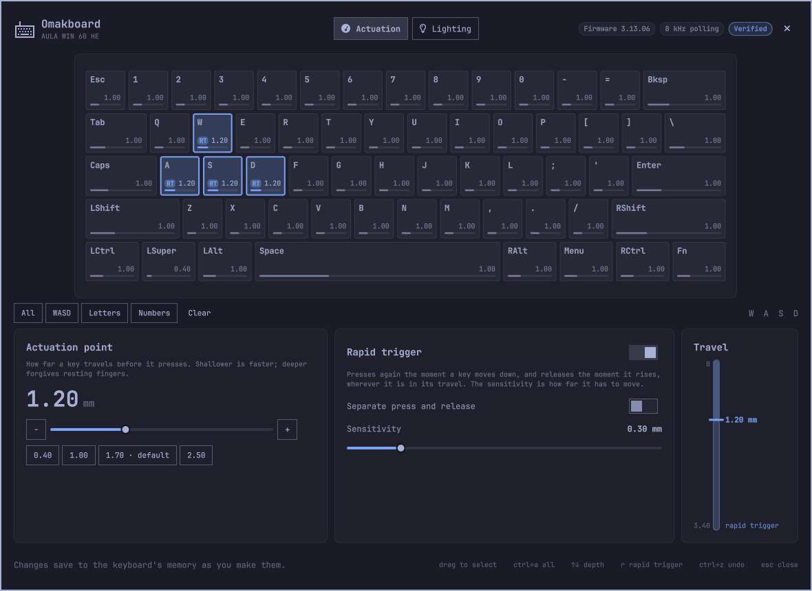
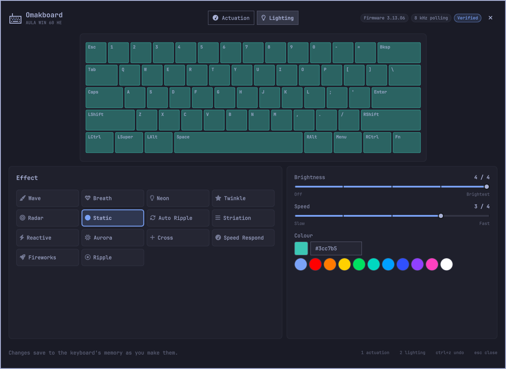

<p align="center">
  
</p>

<p align="center">Tune a Hall-effect keyboard on <a href="https://omarchy.org">Omarchy</a>: actuation depth, rapid trigger and lighting, key by key.</p>

<p align="center">
  
</p>

I built Omakboard for my own keyboard, an AULA WIN 60 HE, and share it for anyone who wants it.
It works on that keyboard, it is careful with it, and it is offered as is.

Hall-effect keyboards keep their settings in their own memory, and AULA sets them from a browser
driver. Omakboard does the same from an Omarchy overlay that follows your theme, and from a
command for scripts, with no browser or vendor site involved. Every change is checked against the
keyboard's limits before it is sent, backed up, and read back from the keyboard afterwards.

## Status

On the AULA WIN 60 HE, Omakboard reads and changes **actuation depth**, **rapid trigger** (one
sensitivity, or separate press and release) and **lighting** (effect, brightness, speed, colour).
Each was captured from AULA's own driver and checked on the keyboard.

SOCD, dynamic keystrokes, dead bands, polling rate and per-key RGB are decoded
(`notes/protocol-aula-ff1b.md`) but not written yet. For those, AULA's web driver works on Linux
in Chromium once Omakboard's udev rule is installed.

## Install on Omarchy

```bash
omarchy plugin add https://github.com/elberacasa/omakboard --enable
```

The keyboard icon on the bar offers to finish the install: it runs this plugin's own
`install.sh` in a terminal, which downloads the `omakboard` command from this repository's
releases, checks its SHA-256, and installs a udev rule (sudo, once) so your user can reach
the keyboard's settings.

Other Arch systems can install the AUR package `omakboard` once it is published, or build
with `cargo install --path .` and install `packaging/udev/70-omakboard.rules` by hand.

If the overlay does not open after `omarchy plugin update` adds new files to the plugin, run
`omarchy restart shell` once: the shell keeps a list of each plugin folder's files from when it
first loaded them.

## The overlay

Click the keyboard icon on the bar. The overlay draws your keyboard key by key and follows your
Omarchy theme.

<p align="center">
  
</p>

- **Actuation**: click a key, shift-click or ctrl-click to add more, or drag across the board to
  select a group (or use All, WASD, Letters, Numbers). Each key shows its actuation depth and a
  tag when rapid trigger is on. Set the depth with the slider, the − and + buttons or a preset,
  turn rapid trigger on, and set its sensitivity, separately for press and release if you like.
- **Lighting**: pick an effect, brightness, speed and colour; the drawing previews the colour.

Changes save to the keyboard a moment after you make them, and each is read back from the
keyboard; the footer says when. Undo, or ctrl+z, puts back what the last save replaced. The first
change of a session saves a backup of everything first.

To open it from a Hyprland keybind, run `omarchy-shell shell toggle io.github.elberacasa.omakboard '{}'`.
The payload can pick a page and keys: `'{"tab": "lighting"}'` or `'{"select": "wasd"}'`.

Keys: `ctrl+a` select all, `↑` `↓` move the depth by 0.05 mm (`shift` for 0.01 mm), `r` rapid
trigger, `1` `2` switch pages, `esc` clear the selection or close.

## Supported keyboards

| Keyboard | USB id | Product | Status |
|---|---|---|---|
| AULA WIN 60 HE | 2e3c:c365 | SI2825KZHEARGB | **Verified** on firmware 3.13.06 |

AULA ships several boards on the same USB id (the WIN 68 HE and KP-TE153 among them), so
Omakboard confirms the model from the product name the keyboard reports before it reads
anything else, and stops if the name is not one it knows.

Statuses mean:

- **Verified**: every feature Omakboard offers for this model was checked on the model itself.
- **Untested**: shares a verified protocol, but nobody has checked this model.
- **Research**: detected and readable; nothing is written.

Have another Hall-effect keyboard? Open a *Keyboard report* issue with the output of
`omakboard devices --json` and `omakboard info`.

## Commands

```bash
omakboard info                              # model, firmware, limits, lighting
omakboard triggers                          # every key's actuation point and rapid trigger

omakboard actuation 1.20 W A S D            # actuate at 1.20 mm
omakboard actuation 1.70 --all
omakboard rapid-trigger on W A S D          # 0.50 mm, or what the key already had
omakboard rapid-trigger on --sensitivity 0.30 W A S D
omakboard rapid-trigger on --press 0.20 --release 0.40 W
omakboard rapid-trigger off --all
omakboard lighting --mode auto-ripple --brightness 3 --color 00a0ff

omakboard backup                            # save everything to ~/.local/state/omakboard/backups/
omakboard restore <backup.json>             # put a backup back

omakboard devices [--json]                  # plugged-in keyboards (the bar widget reads this)
omakboard doctor                            # what is missing, and the exact step that fixes it
omakboard serve                             # the overlay's connection: JSON lines on stdin/stdout
```

Every change command accepts `--dry-run`, which prints the plan and the exact frames it would
send, and sends nothing.

## How changes are made

1. Omakboard reads the keyboard's identity, limits and every key's settings.
2. It works out which keys actually change, and checks every value against the limits the
   keyboard reports (actuation 0.08-3.40 mm, rapid trigger 0.01-1.70 mm on the WIN 60 HE).
   Nothing is sent unless all of it is valid.
3. It saves a backup of everything it read, including the raw replies.
4. It writes only what differs, one frame per group of keys that end up alike, and waits for
   the keyboard to acknowledge each.
5. It reads every changed setting back and compares. If anything differs it says so and prints
   the `omakboard restore` command for the backup from step 3.

Omakboard refuses, in every build, to send the frames that factory-reset the keyboard, reset
all triggers, or start switch calibration. The overlay and the command take turns: only one of
them talks to the keyboard at a time.

## What Omakboard leaves alone

- **Remapping and layers.** On Omarchy that is [keyd](https://github.com/rvaiya/keyd)'s job,
  and it does it better than firmware can. `omakboard doctor` notices keyd configs that apply
  to your keyboard and leaves them be.
- **Typing.** The udev rule opens only the keyboard's vendor configuration interface. The
  interfaces you type through keep their system defaults.
- **Firmware updates.** The protocol has no way to flash firmware, and Omakboard adds none.

## How it works

Omakboard finds a keyboard's configuration interface by the shape of its HID report
descriptor (for AULA, vendor usage page `0xFF1B`, usage `0x91`, 63-byte reports) rather than
by hidraw or interface number. Each vendor protocol is a backend, so another keyboard family
is a new module, not a rewrite.

`notes/protocol-aula-ff1b.md` documents AULA's protocol and marks which parts were seen on the
wire; `notes/hardware.md` records the WIN 60 HE's interfaces; `research/tools/` holds the
capture tooling.

## License

Omakboard is an independent project, not affiliated with or endorsed by AULA.


Licensed under either of [Apache License, Version 2.0](LICENSE-APACHE) or
[MIT license](LICENSE-MIT) at your option.
